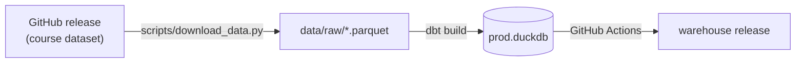
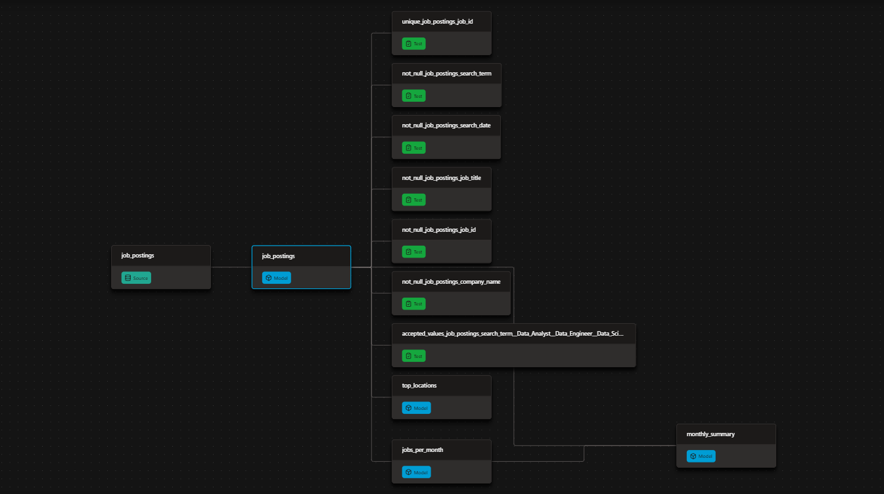
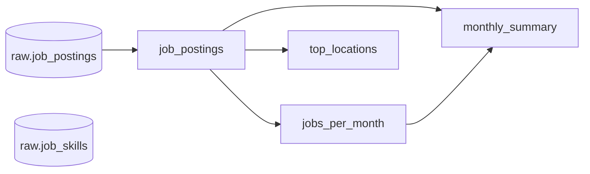

# dbt + DuckDB job market pipeline

An analytics pipeline that turns a year of scraped data-job postings (July 2025 to June 2026) into query-ready tables. Raw parquet files are modeled with [dbt](https://www.getdbt.com/) (Fusion engine) on [DuckDB](https://duckdb.org/), tested on every build, and published by GitHub Actions as a single DuckDB file anyone can query.

📖 **[Browse the dbt docs](https://symeon158.github.io/dbt-duckdb-pipeline/)**: every model, column, test and the lineage graph, rebuilt on every run.

It answers questions like:

- How many Data Analyst, Data Engineer and Data Scientist postings appear each month?
- What share of postings are remote, and how does that change over time?
- Which locations have the most openings?

## How it works



1. **Extract.** [scripts/download_data.py](scripts/download_data.py) downloads 13 parquet files (about 85 MB) into `data/raw/`: 12 monthly files of job postings plus one file of skills mentioned in each posting.
2. **Transform and test.** The dbt project in [analytics/](analytics/) reads the parquet files directly as sources, cleans them into a `job_postings` model, builds summary models on top, and runs data tests on sources and models.
3. **Publish.** On every push to `master`, every Monday, and on demand, [the workflow](.github/workflows/dbt_build.yml) rebuilds everything from scratch, uploads `prod.duckdb` to the [`warehouse` release](https://github.com/symeon158/dbt-duckdb-pipeline/releases/tag/warehouse), and deploys the [dbt docs site](https://symeon158.github.io/dbt-duckdb-pipeline/) to GitHub Pages.

The lineage graph from the dbt docs, showing the source, the four models and the tests on `job_postings`:



## Query the published warehouse

No setup needed beyond the [DuckDB CLI](https://duckdb.org/docs/installation/) (1.1 or later):

```sql
ATTACH 'https://github.com/symeon158/dbt-duckdb-pipeline/releases/download/warehouse/prod.duckdb'
    AS warehouse (READ_ONLY);

SELECT * FROM warehouse.monthly_summary;
SELECT * FROM warehouse.top_locations;
SELECT * FROM warehouse.jobs_per_month WHERE role = 'Data Engineer';
```

`jobs_per_month`, `monthly_summary` and `top_locations` are stored as tables inside the file. `job_postings` is a view over the local parquet files, so it only works in a clone that has run the download script.

## Run it locally

**Prerequisites:** [uv](https://docs.astral.sh/uv/) and, optionally, the [DuckDB CLI](https://duckdb.org/docs/installation/) for exploring results.

```bash
git clone https://github.com/symeon158/dbt-duckdb-pipeline.git
cd dbt-duckdb-pipeline
uv sync                                  # Python 3.10 + dbt
uv run scripts/download_data.py          # run from the repo root
```

Create `~/.dbt/profiles.yml` (on Windows, `C:\Users\<you>\.dbt\profiles.yml`):

```yaml
analytics:
  target: dev
  outputs:
    dev:
      type: duckdb
      path: ../data/dev.duckdb
      threads: 1
    prod:
      type: duckdb
      path: ../data/prod.duckdb
      threads: 4
```

Then build and test everything. Run dbt from inside `analytics/`, because the database and parquet paths are relative to it:

```bash
cd analytics
uv run dbt build                  # models + tests into data/dev.duckdb
uv run dbt build --target prod    # same, into data/prod.duckdb
uv run dbt show --select monthly_summary
```

To browse the results in DuckDB's web UI:

```bash
duckdb -readonly -ui ../data/dev.duckdb
```

`-readonly` lets the UI stay open while dbt writes to the same file; without it dbt fails with "file is already open".

## Project structure

```
.
├── .github/workflows/dbt_build.yml   CI: build, test and publish the warehouse
├── analytics/                        dbt project
│   ├── dbt_project.yml               project config (materializations, persist_docs)
│   └── models/
│       ├── sources.yml               raw parquet files declared as dbt sources
│       ├── properties.yml            model descriptions, columns and tests
│       └── *.sql                     one file per model
├── ci/profiles.yml                   dbt connection used by GitHub Actions
├── docs/lineage.png                  lineage screenshot used in this README
├── scripts/
│   ├── download_data.py              fetches the raw dataset into data/raw/
│   └── generate_docs.py              writes the data catalog below into this README
├── data/                             raw files and .duckdb databases (git-ignored)
└── pyproject.toml, uv.lock           Python environment, managed by uv
```

## Design notes

- **Sources read parquet in place.** `sources.yml` maps each source to a file pattern with `external_location`, so there is no load step and models use `{{ source('raw', 'job_postings') }}` instead of hard-coded paths.
- **Materializations.** Models are tables by default (set in `dbt_project.yml`) so the published file is self-contained; `job_postings` is a view, since it is a thin filter over the raw files.
- **Descriptions live in the database.** `persist_docs` writes every model and column description from `properties.yml` into DuckDB as comments, visible in `information_schema.columns.column_comment` and in the DuckDB UI.
- **Failed scrapes are dropped early.** About 151,000 of the 843,000 raw rows have `error` set and almost no data; `job_postings` keeps only rows where `error is null`.

## Data quality

Tests run on every `dbt build`, locally and in CI. Most are blocking: a failure stops the build. Two are warnings on purpose:

- `job_id` is not unique in `job_postings` (691,950 rows, 491,140 distinct IDs), because the same posting is found by searches on different days.
- 6,255 postings have no `job_id`.

Both are tracked as warnings so they stay visible without blocking builds. Deduplicating to one row per job, for example keeping the latest `search_date` per `job_id`, would let them become blocking tests.

## Updating the docs

The data catalog below is generated from dbt's manifest, so it always matches the YAML files. After changing a model, a description or a test, regenerate it from the repo root:

```bash
cd analytics && uv run dbt parse && cd ..
uv run python scripts/generate_docs.py
```

The script only replaces the text between the `DOCS:START` and `DOCS:END` markers. To change what it says, edit `sources.yml` or `properties.yml`, not the generated section.

<!-- DOCS:START - generated by scripts/generate_docs.py, do not edit by hand -->

## Data catalog

2 sources, 4 models and 25 tests, generated from the dbt manifest.

### Lineage



### Sources

#### `raw.job_postings`

One row per posting returned by a search, across all monthly files. Includes rows where the scrape failed (error is true), which have most other columns empty.

- **Location:** `../data/raw/raw_job_postings_*.parquet`

| Column | Description | Tests |
| --- | --- | --- |
| `job_id` | Identifier of the posting. Empty on failed scrapes. |  |
| `job_title` | Title of the position as listed in the posting. |  |
| `company_name` | Name of the hiring company. |  |
| `job_location` | Location as listed in the posting. |  |
| `job_via` | Job board or site the posting was found through. |  |
| `job_posted_at` | Relative posting age as text, e.g. "3 days ago". |  |
| `job_salary` | Salary as listed in the posting, as free text. |  |
| `job_schedule_type` | Employment type, such as Full-time or Contractor. |  |
| `job_work_from_home` | True when the posting is marked as remote; null otherwise. |  |
| `job_extensions_raw` | Extra posting attributes as returned by the source, unparsed. |  |
| `job_detected_extensions_raw` | Attributes detected by the source (e.g. schedule, salary), unparsed. |  |
| `search_time` | Timestamp the search ran. | `not_null` |
| `search_date` | Date the search ran. | `not_null` |
| `search_term` | Search query that returned the posting. | `accepted_values: Data Analyst, Data Engineer, Data Scientist` `not_null` |
| `search_location` | Location the search was run for. |  |
| `error` | True when the scrape failed for this row; null otherwise. |  |
| `error_message` | Error returned when the scrape failed. |  |

#### `raw.job_skills`

Skills mentioned in each posting, one row per posting and skill.

- **Location:** `../data/raw/raw_job_skills.parquet`

| Column | Description | Tests |
| --- | --- | --- |
| `job_id` | Posting the skill was found in; matches job_postings.job_id. | `not_null` |
| `skill_keyword` | Skill as a normalized keyword, e.g. "python". | `not_null` |
| `skill_id` | Identifier of the skill. | `not_null` |

### Models

#### `job_postings`

Job postings loaded from the monthly raw parquet files, excluding rows that failed to scrape. One row per posting per search, so the same job can appear more than once.

- **Materialized as:** view
- **File:** [`analytics/models/job_postings.sql`](analytics/models/job_postings.sql)
- **Depends on:** `raw.job_postings`

| Column | Description | Tests |
| --- | --- | --- |
| `job_id` | Identifier of the posting. Repeats when a job is found by more than one search. | `not_null (warn)` `unique (warn)` |
| `job_title` | Title of the position as listed in the posting. | `not_null` |
| `company_name` | Name of the hiring company. | `not_null` |
| `job_location` | Location as listed in the posting, e.g. a city or "Anywhere". |  |
| `job_via` | Job board or site the posting was found through. |  |
| `job_schedule_type` | Employment type, such as Full-time, Part-time, Contractor or Internship. |  |
| `job_work_from_home` | True when the posting is marked as remote; null otherwise. |  |
| `search_date` | Date the posting was collected. | `not_null` |
| `search_term` | Search query that returned the posting. | `accepted_values: Data Analyst, Data Engineer, Data Scientist` `not_null` |

#### `jobs_per_month`

Number of postings per month for each role.

- **Materialized as:** table
- **File:** [`analytics/models/jobs_per_month.sql`](analytics/models/jobs_per_month.sql)
- **Depends on:** `job_postings`

| Column | Description | Tests |
| --- | --- | --- |
| `month` | First day of the month the postings were collected. | `not_null` |
| `role` | Role searched for, taken from search_term in job_postings. | `accepted_values: Data Analyst, Data Engineer, Data Scientist` `not_null` |
| `postings` | Number of postings for that month and role. | `not_null` |

#### `monthly_summary`

Total postings per month across all roles, with the number and share that are remote.

- **Materialized as:** table
- **File:** [`analytics/models/monthly_summary.sql`](analytics/models/monthly_summary.sql)
- **Depends on:** `job_postings`, `jobs_per_month`

| Column | Description | Tests |
| --- | --- | --- |
| `month` | First day of the month the postings were collected. | `not_null` `unique` |
| `total_postings` | Number of postings that month, summed over all roles in jobs_per_month. | `not_null` |
| `remote_postings` | Number of postings that month marked as remote (job_work_from_home is true). | `not_null` |
| `pct_remote` | Remote postings as a percentage of total postings, rounded to one decimal. | `not_null` |

#### `top_locations`

The 10 locations with the most postings.

- **Materialized as:** table
- **File:** [`analytics/models/top_locations.sql`](analytics/models/top_locations.sql)
- **Depends on:** `job_postings`

| Column | Description | Tests |
| --- | --- | --- |
| `job_location` | Location as listed in the posting. | `unique` |
| `postings` | Number of postings for that location. | `not_null` |

<!-- DOCS:END -->

## Credits

The dataset and download script come from Luke Barousse's [dbt Analytics Engineering Course](https://github.com/lukebarousse/dbt_Analytics_Engineering_Course).
